<!-- Traducción de README.md: la página en inglés es la referencia. -->

<h1 align="center">
  <a href="https://github.com/OZBM/MacLC/releases/latest">
    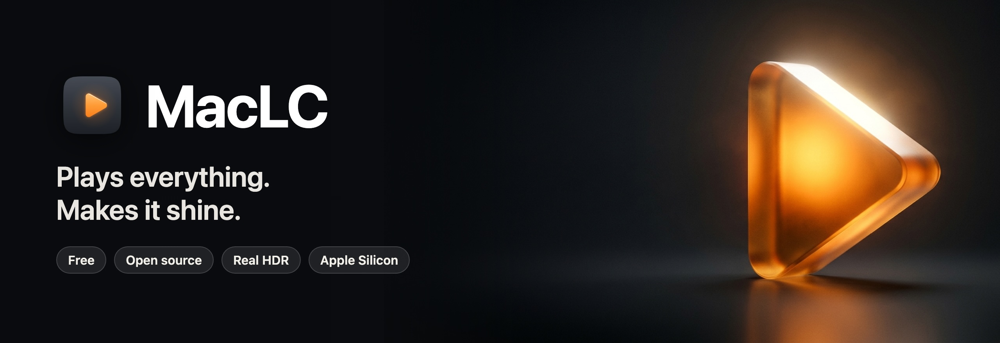
  </a>
</h1>

<p align="center">
  <b>El reproductor de video gratuito para Mac que lo reproduce todo y lo hace brillar.</b><br>
  HDR real, SDR&nbsp;a&nbsp;HDR, nueve métodos de escalado, movimiento fluido, Voice&nbsp;Boost y una biblioteca al estilo de la app Apple&nbsp;TV, en una sola app nativa para Apple&nbsp;Silicon.
</p>

<p align="center">
  <a href="https://github.com/OZBM/MacLC/releases/latest"></a>
  <a href="https://www.hazenstudio.com/maclc/donate/"></a>
</p>

<p align="center">
  
  
  
  <a href="COPYING"></a>
</p>

<p align="center">
  <a href="README.md">English</a> · <a href="README.fr.md">Français</a> · <a href="README.zh-CN.md">简体中文</a> · <a href="README.ja.md">日本語</a> · <b>Español</b> · <a href="README.de.md">Deutsch</a>
</p>

<picture>
  <source media="(prefers-color-scheme: dark)" srcset=".github/readme/library-dark.webp">
  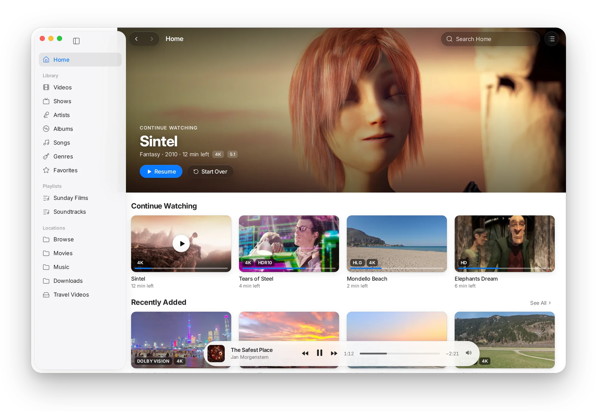
</picture>

## Por qué MacLC

<table>
<tr>
<td width="50%" valign="top">

**Lo reproduce todo.** MKV, MP4, AVI, WebM, TS, AV1, HEVC, FLAC, DTS, subtítulos en SRT, ASS y más, y hasta esos archivos raros que otros reproductores rechazan. Sin códecs que instalar.

</td>
<td width="50%" valign="top">

**HDR real.** Dolby Vision, HDR10+, HDR10 y HLG con sus altas luces reales en un MacBook Pro o cualquier pantalla HDR, y subtítulos en un blanco cómodo.

</td>
</tr>
<tr>
<td valign="top">

**SDR a HDR.** Los videos comunes aprovechan el brillo extra de tu pantalla: lámparas, cielos y reflejos empiezan a resplandecer, mientras que los rostros y las sombras se mantienen cerca de como se filmaron.

</td>
<td valign="top">

**Más nítido, más fluido.** Nueve métodos de escalado por GPU (MetalFX, FSR, NIS, Anime4K…) para videos pequeños en pantallas grandes, e interpolación de fotogramas hasta la frecuencia de actualización de tu pantalla, 120&nbsp;Hz en ProMotion.

</td>
</tr>
<tr>
<td valign="top">

**Una verdadera app para Mac.** Liquid Glass, menús y atajos de Mac, una biblioteca al estilo de la app Apple TV y ajustes que explican qué hace cada opción.

</td>
<td valign="top">

**Y más.** Voice Boost para diálogos más claros, Watch para catálogos de complementos, torrents que se reproducen mientras se descargan, YouTube (con yt-dlp, gratuito) y Play on TV (beta).

</td>
</tr>
</table>

<p align="center"><b>Gratis. Sin anuncios, sin cuenta, sin rastreo.</b> Código abierto bajo licencia GPL.</p>

## HDR que aprovecha toda tu pantalla

**¿Estás leyendo esto en un MacBook Pro? Mira la imagen de abajo en Safari.** Es una ilustración: un fotograma de película inventado, renderizado desde cero, preparado para SDR a la izquierda y para HDR a la derecha. El SDR blanquea el neón y el sol hasta un blanco plano; en una pantalla HDR, la mitad derecha conserva sus colores y brilla de verdad más que el blanco de esta página.

<p align="center">
  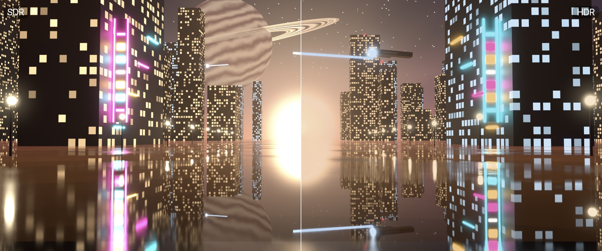
</p>

La pantalla de un MacBook Pro puede mostrar altas luces varias veces más brillantes que el blanco. MacLC está diseñado en torno a eso.

- **Dolby Vision, HDR10+, HDR10 y HLG**, cada uno mostrado de la mejor manera que admite tu pantalla, incluidos los videos HDR que graba tu iPhone.
- **El brillo adecuado en cada pantalla.** MacLC mide la pantalla en la que está cada ventana y vuelve a medirla cuando la mueves a otro monitor.
- **HDR también en pantallas convencionales**, adaptado a lo que la pantalla puede mostrar en lugar de recortarse en un blanco plano.
- **Subtítulos cómodos de mirar.** Se mantienen en un blanco suave en lugar de brillar como el destello más intenso de la película.
- **AV1 por hardware** en M3 y posteriores, y AV1 por software en todos los demás.

El propio motor de video en Metal de MacLC renderiza Dolby Vision y HDR10+, y corrige los seis defectos de HDR detectados en el código sobre el que se basa ([detalles](#bajo-el-capó)).

### SDR a HDR: luz donde tu pantalla tiene de sobra

La mayoría de los videos son SDR: sus altas luces se quedan en el blanco, incluso en una pantalla capaz de mostrar mucho más. SDR a HDR eleva esas altas luces al brillo extra de tu pantalla y mantiene los rostros y las sombras cerca de cómo se filmaron.

<picture>
  <source media="(prefers-color-scheme: dark)" srcset=".github/readme/sdr-to-hdr-curve-dark.svg">
  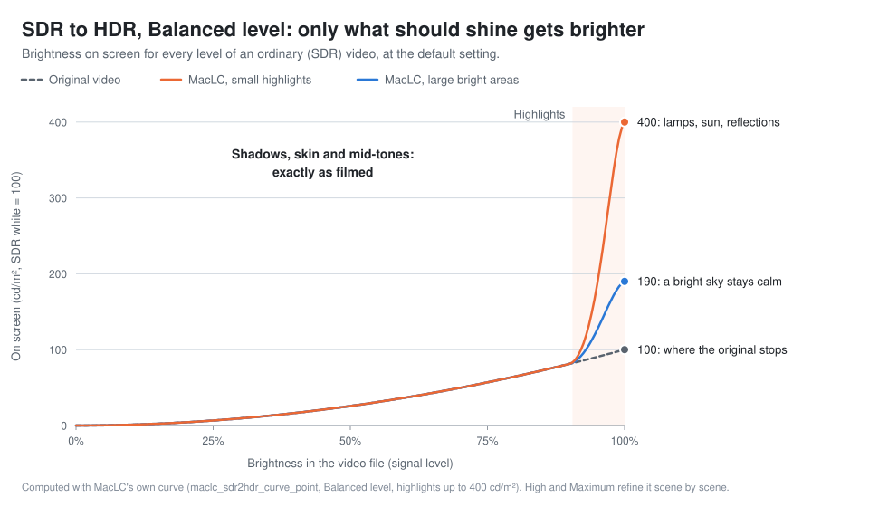
</picture>

Elige un nivel desde Fast hasta Maximum, o deja que Auto escoja uno al que tu Mac pueda seguirle el ritmo. High y Maximum usan pequeñas redes neuronales entrenadas para MacLC, de aproximadamente medio milisegundo por fotograma en un M3 Max. Tú defines hasta qué brillo pueden llegar las altas luces, y **Hold to Compare** muestra el original mientras mantienes presionado.

<details>
<summary>Verlo en un video real</summary>

Un fotograma de la película abierta *Sintel* dos veces: a la izquierda tal como se filmó, a la derecha tal como MacLC lo mostró en un MacBook Pro con SDR a HDR en el nivel Maximum, capturado desde la app. En una pantalla HDR en Safari, el sol de la derecha resplandece.

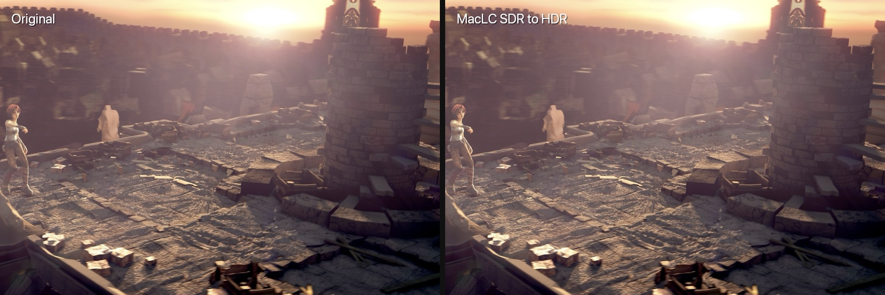
</details>

<p align="center">
  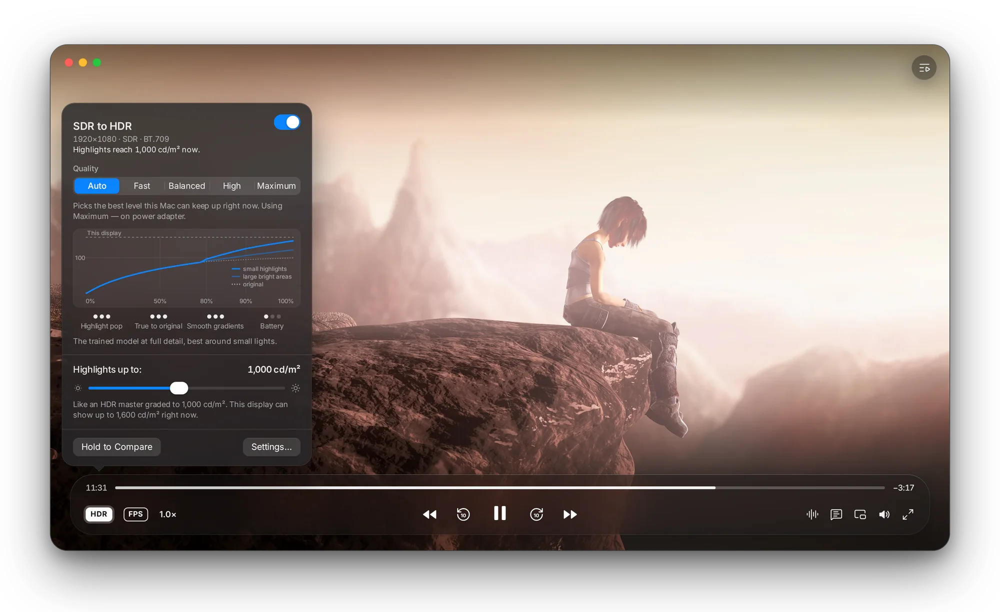
</p>

## Más nítido y más fluido

**Escalado.** Un episodio en 720p en una pantalla 5K merece algo mejor que verse borroso. MacLC amplía los videos pequeños en la GPU, con nueve métodos para elegir, cada uno explicado con palabras sencillas en su panel:

| Método | Ideal para |
|---|---|
| Auto | Elige por ti: superresolución de Apple en videos pequeños y luego MetalFX |
| Apple Neural 4x | Modelo neuronal 4× de Apple (una única descarga desde Apple); baja a 2× cuando el Mac no puede seguir el ritmo |
| Anime y Anime4K | Animación dibujada: trazos limpios y colores planos |
| FSRCNNX | Detalle fino (se descarga solo después de aceptar su licencia) |
| Sharp (AMD FSR 1) y NIS (NVIDIA Image Scaling) | Bordes definidos casi sin costo |
| Efficient (MetalFX) | Duración de la batería |
| Classic (EWA Lanczos) | Mantenerse lo más fiel posible al original |

Las pasadas neuronales de Apple, Anime, Anime4K y FSRCNNX funcionan en video SDR de 8 bits. En video HDR y de 10 bits, y con SDR a HDR activado, MacLC utiliza los demás métodos.

**Compare Before and After.** Divide la imagen por la mitad en el video que estás viendo: a la izquierda sin SDR a HDR, escalado ni interpolación; a la derecha, con ellos.

**Movimiento fluido.** La interpolación de fotogramas eleva los 24 fps hasta la frecuencia de actualización de tu pantalla: 60 Hz, 120 Hz en un MacBook Pro con ProMotion, o más en un monitor externo rápido. El modo automático elige un método que mantiene el ritmo en tiempo real; el flujo óptico y RIFE, una red neuronal, se pueden elegir manualmente. Viene desactivado por defecto, porque los puristas del cine también tienen razón.

<picture>
  <source media="(prefers-color-scheme: dark)" srcset=".github/readme/motion-demo-dark.svg">
  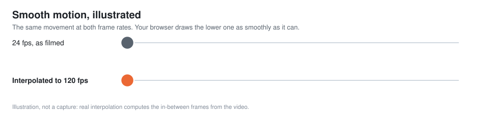
</picture>

<p align="center">
  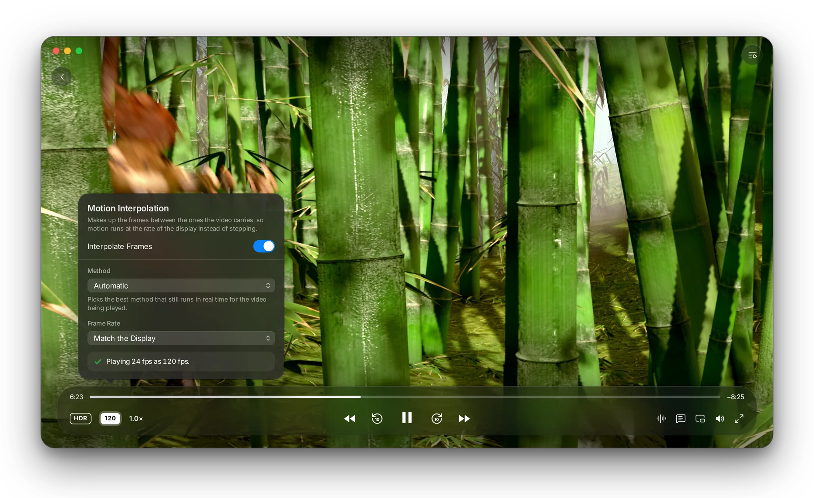
</p>

## Una biblioteca que vale la pena abrir

Indícale tus carpetas a MacLC y creará una biblioteca al estilo de la app Apple TV: **Inicio** con lo que estabas viendo, y luego **Videos, Series, Artistas, Álbumes, Canciones, Géneros, Favoritos y Listas de reproducción**. Los episodios con nombres como `Show S01E02` se agrupan en temporadas, las tarjetas llevan insignias **Dolby Vision, HDR10, HLG y 4K**, y una cápsula flotante de En reproducción mantiene la imagen viva mientras exploras. Tus archivos nunca se mueven.

**Watch** explora catálogos de películas y series al estilo de la app Apple TV, con títulos destacados, estantes, un Top 10, géneros y páginas de títulos con reparto y episodios. Cinemeta, integrado, aporta pósteres, detalles y búsqueda; lo que puedas reproducir depende de los complementos que instales, que usan el [protocolo de complementos de Stremio](https://github.com/Stremio/stremio-addon-sdk/blob/master/docs/protocol.md). Favoritos, el historial y Seguir viendo se quedan en tu Mac.

<picture>
  <source media="(prefers-color-scheme: dark)" srcset=".github/readme/watch-dark.webp">
  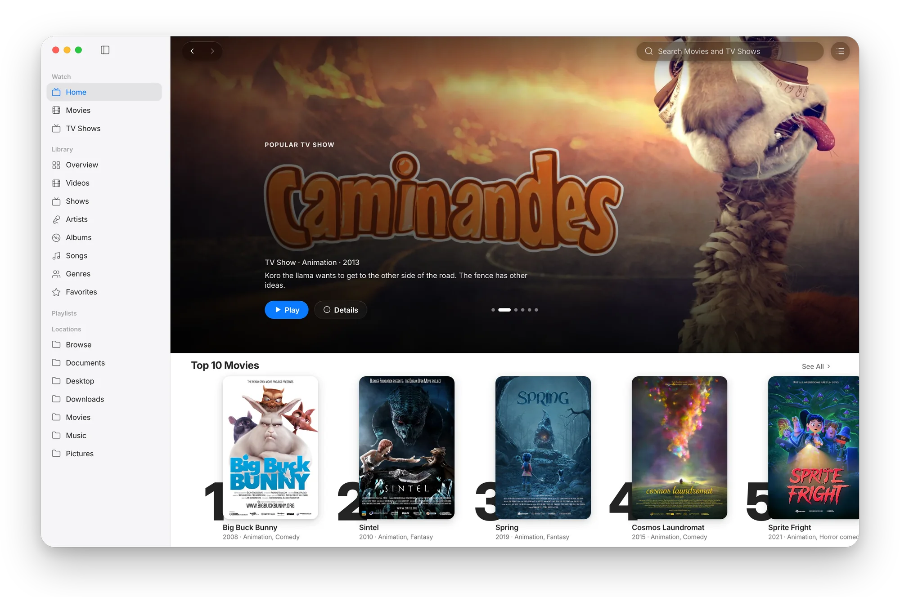
</picture>

- **Torrents que se reproducen mientras se descargan.** Abre un archivo `.torrent` o pega un enlace magnet: la reproducción comienza en cuanto se verifican unos segundos, y un marcador en la barra de reproducción muestra lo almacenado en búfer, la velocidad y los pares.
- **YouTube** con Inicio, Suscripciones, Ver más tarde, listas de reproducción y búsqueda. Necesita la herramienta gratuita [`yt-dlp`](https://github.com/yt-dlp/yt-dlp), y MacLC te muestra el único comando que la instala. Iniciar sesión es opcional: en la propia página de Google o con la sesión de un navegador donde ya hayas iniciado sesión. MacLC guarda solo las cookies de sesión que yt-dlp necesita, en un archivo privado en tu Mac, y Cerrar sesión lo elimina.
- **Play on TV (beta).** Envía lo que se está reproduciendo a un Apple TV u otro receptor AirPlay, o a un Chromecast.

MacLC no incluye películas, series ni transmisiones. Los complementos son servicios de terceros: úsalos solo con contenido que tengas derecho a ver.

## Diálogos fáciles de seguir

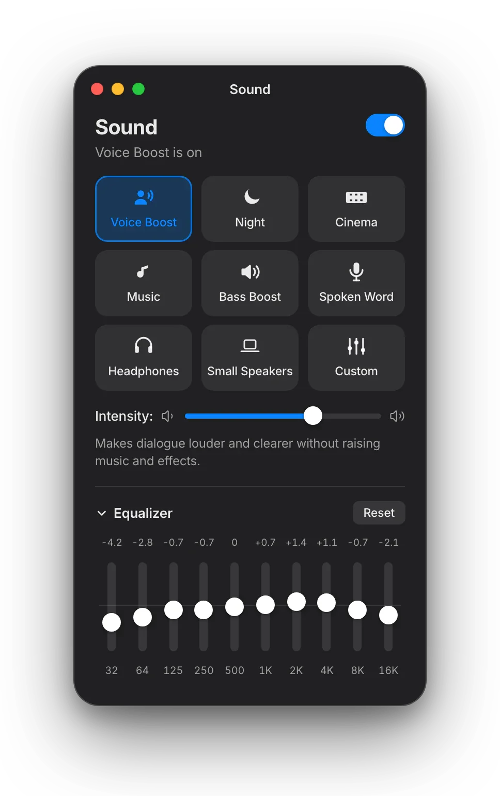

**Voice Boost** hace que los diálogos se escuchen más claros sin subir la música. En películas 5.1 realza el canal central (+7,4&nbsp;dB de ventaja en los diálogos, medido). En estéreo aísla la voz en el centro de la mezcla, en tiempo real en vDSP de Apple (+4,8&nbsp;dB en la banda de voz de 1 a 4&nbsp;kHz, medido en una mezcla real, con unos 16&nbsp;ms de latencia).

Además: modos **Noche, Cine, Música, Refuerzo de graves, Voz hablada, Auriculares y Altavoces pequeños**, cada uno con un control deslizante de intensidad, un **ecualizador de 10 bandas** (⌥⌘E) y un limitador que evita la saturación en las escenas fuertes.

<br clear="right">

## Ajustes que se explican solos

Una ventana, una barra lateral y un campo de búsqueda. Cada fila indica qué hace la opción en función de lo que verás u oirás. Los ajustes para expertos siguen ahí, detrás de un desplegable.

<picture>
  <source media="(prefers-color-scheme: dark)" srcset=".github/readme/settings-hdr-dark.webp">
  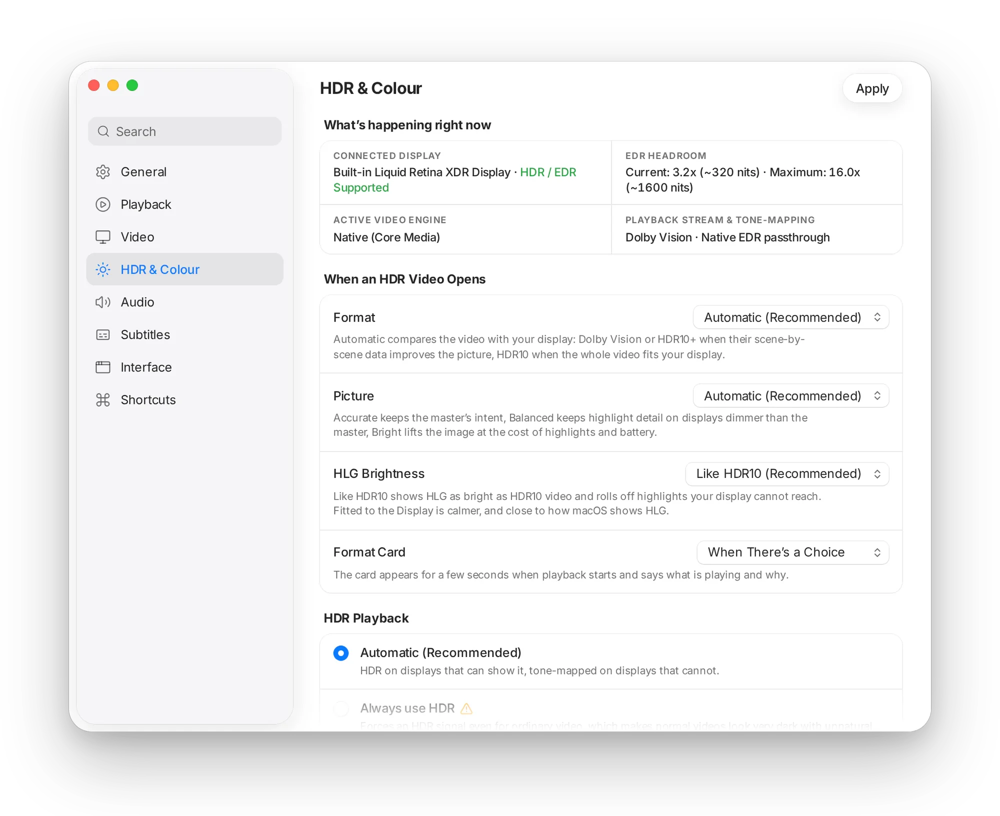
</picture>

## Comparativa

|  | **MacLC** | IINA | Infuse | QuickTime Player |
|---|:---:|:---:|:---:|:---:|
| Reproduce casi cualquier archivo de video | ✅ | ✅ | ✅ algunos audios requieren Pro | ❌ sobre todo MP4 y MOV |
| Video HDR en pantallas HDR | ✅ | ✅ | ✅ | ✅ |
| Hace brillar el video normal en pantallas HDR (SDR a HDR) | ✅ | ❌ | ❌ | ❌ |
| Métodos de escalado integrados | ✅ nueve | ➖ shaders que instalas tú | ✅ un modo con IA | ❌ |
| Movimiento fluido (interpolación de fotogramas) | ✅ integrada | ➖ mediante opciones de mpv | ❌ | ❌ |
| Mejora de diálogos en un clic | ✅ Voice Boost | ❌ filtros manuales | ❌ solo aumento de volumen | ❌ |
| Biblioteca para tus propios videos | ✅ y música | ❌ listas de reproducción e historial | ✅ su especialidad | ❌ |
| Catálogos de complementos y torrents | ✅ | ❌ | ❌ | ❌ |
| YouTube y video web | ✅ con yt-dlp | ✅ con yt-dlp | ❌ | ❌ |
| Gratis | ✅ | ✅ | ➖ Pro es de pago | ✅ con macOS |
| Código abierto | ✅ GPL | ✅ GPL | ❌ | ❌ |

<sub>Comprobado el 3 de noviembre de 2026 con la documentación y las notas de versión de cada reproductor. IINA también es excelente, gratuito y de código abierto.</sub>

## Instalación

<p>
  <a href="https://github.com/OZBM/MacLC/releases/latest"></a>
</p>

1. Descarga `maclc-1.6.dmg` (57,8 MB) desde [la última versión](https://github.com/OZBM/MacLC/releases/latest).
2. Ábrelo y arrastra **MacLC** a **Aplicaciones**.
3. Abre MacLC. La primera vez, macOS lo detiene: haz clic en **OK**, abre **Ajustes del Sistema › Privacidad y seguridad**, baja hasta **Seguridad** y haz clic en **Abrir igualmente** junto a "Se bloqueó MacLC". Confirma con Touch ID o con tu contraseña. Solo haces esto una vez por versión.

> [!NOTE]
> **¿Por qué este clic adicional?** macOS solo abre apps con doble clic cuando su desarrollador paga a Apple 99 € al año por un Developer ID y notariza cada versión. MacLC es gratuito y aún no ha reunido ese dinero. **Los primeros 99 € en donaciones eliminan este paso para todos.** [Donar](https://www.hazenstudio.com/maclc/donate/)

<details>
<summary>Alternativa con Terminal, suma de verificación y requisitos</summary>

En lugar de **Abrir igualmente**, puedes quitar la marca de "descargado de internet":

```bash
xattr -dr com.apple.quarantine /Applications/MacLC.app
```

Comprueba que tu copia sea exactamente la publicada (el valor esperado está en la página de la versión; para la 1.6 es `194de0b42a836985dba92a75d283264e21b4285f5a24934769b0e2aad5aae805`):

```bash
shasum -a 256 ~/Downloads/maclc-1.6.dmg
```

Si alguna vez macOS dice que MacLC "está dañado y no se puede abrir", la descarga está incompleta: elimínala y descárgala de nuevo. No omitas ese mensaje.

**Requisitos**

- Un Mac con Apple Silicon (M1 o posterior). Los Mac con Intel no son compatibles.
- macOS 26 Tahoe o posterior.
- SDR a HDR necesita una pantalla capaz de superar el brillo del blanco (un MacBook Pro con pantalla XDR, un Pro Display XDR, un monitor HDR). Todo lo demás funciona en cualquier pantalla.
- Opcional: [`yt-dlp`](https://github.com/yt-dlp/yt-dlp) para YouTube y video web (`brew install yt-dlp`).

La app es autónoma: FFmpeg, libass, libplacebo, libtorrent y unas 140 bibliotecas más van dentro de ella, con sus licencias en `MacLC.app/Contents/Resources/Licenses/`.

</details>

## Apoya a MacLC

MacLC es un proyecto personal: sin anuncios, sin suscripción y sin datos que vender. Las donaciones pagan lo que una app gratuita no puede conseguir por sí sola, en este orden:

<picture>
  <source media="(prefers-color-scheme: dark)" srcset=".github/readme/donation-milestones-dark.svg">
  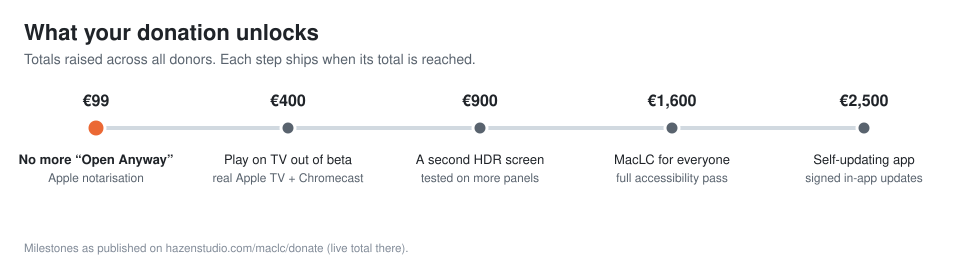
</picture>

**Cada aportación incluye un deseo.** Dime qué debería hacer MacLC después, o apoya un deseo que ya esté en la lista: los deseos con más apoyos van primero. Paga con PayPal o con tarjeta en [la página de donaciones](https://www.hazenstudio.com/maclc/donate/), donde el total recaudado se muestra en vivo.

<p align="center">
  <a href="https://www.hazenstudio.com/maclc/donate/"></a>
</p>

**¿Sin dinero? Esto ayuda igual:**

- ⭐ **Dale una estrella a este repositorio.** Las estrellas son la forma en que la gente encuentra MacLC en GitHub.
- **Cuéntaselo a alguien.** Compártelo en [X](https://x.com/intent/post?text=MacLC%3A%20the%20free%20video%20player%20for%20Mac%20that%20plays%20everything%2C%20with%20real%20HDR%2C%20SDR%20to%20HDR%2C%20upscaling%20and%20smooth%20motion.&url=https%3A%2F%2Fgithub.com%2FOZBM%2FMacLC), [Bluesky](https://bsky.app/intent/compose?text=MacLC%3A%20the%20free%20video%20player%20for%20Mac%20that%20plays%20everything%2C%20with%20real%20HDR%2C%20SDR%20to%20HDR%2C%20upscaling%20and%20smooth%20motion.%20https%3A//github.com/OZBM/MacLC), [Reddit](https://www.reddit.com/submit?url=https%3A%2F%2Fgithub.com%2FOZBM%2FMacLC&title=MacLC%3A%20a%20free%2C%20open-source%20video%20player%20for%20Mac%20with%20real%20HDR%20and%20SDR%20to%20HDR) o [LinkedIn](https://www.linkedin.com/sharing/share-offsite/?url=https%3A%2F%2Fgithub.com%2FOZBM%2FMacLC).
- **Informa de lo que veas.** Un archivo que no se reproduce, un cierre inesperado, un color incorrecto: [abre una incidencia](https://github.com/OZBM/MacLC/issues/new) contando qué hiciste y qué esperabas.
- **Pruébalo en tu pantalla.** Hasta ahora, el HDR de MacLC solo se ha comprobado en un MacBook Pro. Si tienes otra pantalla HDR, cuéntame cómo se ve.

## Preguntas

<details>
<summary><b>¿MacLC es realmente gratuito?</b></summary>

Sí. Sin versión de pago, sin suscripción, sin anuncios, sin cuenta y sin nada reservado. Es de código abierto bajo la licencia GPL 2.0 o posterior.
</details>

<details>
<summary><b>¿Es seguro? ¿Por qué macOS lo bloquea la primera vez?</b></summary>

Todo el código fuente es público en este repositorio, y MacLC no tiene analíticas ni rastreo: no informa de lo que ves ni a su desarrollador ni a nadie más. Watch, YouTube y los torrents se conectan a los servicios que usan, como haría cualquier app. macOS bloquea MacLC la primera vez únicamente porque no está notarizado por Apple, lo cual cuesta 99 € al año (consulta [Instalación](#instalación)). Cada versión publica la suma de verificación SHA-256 de la imagen de disco para que puedas comprobar tu copia.
</details>

<details>
<summary><b>¿Necesito una pantalla HDR?</b></summary>

No. MacLC reproduce todos los videos en cualquier pantalla de Mac y adapta las películas HDR a las pantallas convencionales. Solo SDR a HDR necesita una pantalla capaz de brillar más que el blanco.
</details>

<details>
<summary><b>¿Funciona en Mac con Intel o en macOS 15 y versiones anteriores?</b></summary>

No. MacLC está dirigido a Apple Silicon y macOS 26 Tahoe o posterior, y las bibliotecas que incluye requieren macOS 26.
</details>

<details>
<summary><b>¿Cómo lo actualizo?</b></summary>

Descarga la nueva imagen de disco desde [Releases](https://github.com/OZBM/MacLC/releases) y reemplaza la app. Las actualizaciones que se instalan solas están en la hoja de ruta de donaciones. Para enterarte de las nuevas versiones, haz clic en el botón **Watch** de GitHub en la parte superior de esta página y luego en **Custom › Releases**.
</details>

<details>
<summary><b>¿El movimiento fluido no hará que las películas parezcan una telenovela?</b></summary>

Puede pasar, y por eso viene desactivado por defecto. A mucha gente le gusta para deportes, naturaleza y animación, y conserva el aspecto clásico de 24 fotogramas para el cine. Prueba ambos en la misma escena.
</details>

<details>
<summary><b>¿MacLC viene con películas o series?</b></summary>

No. MacLC reproduce tus propios archivos y lo que tú abras. Watch muestra los catálogos de los complementos que elijas instalar, que son servicios de terceros: úsalos solo con contenido que tengas derecho a ver.
</details>

## Bajo el capó

MacLC se construye sobre parte del código abierto de VLC 4, principalmente su motor de reproducción (`libVLC`). La interfaz, la biblioteca y Watch, la salida de video en Metal, la cadena HDR, SDR a HDR, el escalado, la interpolación de movimiento, Voice Boost y AirPlay se escribieron o reconstruyeron para MacLC, únicamente para macOS en Apple Silicon.

<details>
<summary><b>Cadena HDR: seis defectos corregidos en el código heredado</b></summary>

A partir de una auditoría de la ruta HDR en macOS de VLC 4.0.0-dev en Apple Silicon (2 de septiembre de 2026, base `99034f9`):

| Defecto | Lo que se veía | Corrección |
|---|---|---|
| Margen EDR leído una sola vez desde `[NSScreen mainScreen]` | Al mover la ventana a otro monitor, el HDR quedaba con un brillo incorrecto | Margen reevaluado al cambiar de pantalla, perfil o parámetros |
| Las preferencias de modo HDR y margen EDR no hacían nada | Los ajustes eran decorativos | Conectadas a callbacks de variables en vivo, aplicadas durante la reproducción |
| Sin rama de mapeo de tonos SDR | Las películas HDR en pantallas SDR se recortaban en un blanco plano | `CADynamicRangeStandard` con `CAToneMapModeAutomatic`, reetiquetado BT.709 de respaldo |
| Subtítulos sin etiquetar sobre video PQ | Subtítulos blancos a plena luminancia PQ sobre escenas oscuras | Capa de subtítulos etiquetada como sRGB, escalada al blanco de referencia BT.2408 |
| HEVC de más de 10 bits reducido a BGRA de 8 bits | Las fuentes de 12 bits y 16 bits perdían bits antes de llegar a la pantalla | Redirigido a P010; 4:2:2 de 16 bits conectado mediante las funciones auxiliares de CVPX |
| HDR inferior a 4K etiquetado como BT.709, emisión de volumen de masterización de cero nits | Contenido de gama amplia mostrado con primarios incorrectos | Etiquetado correcto por flujo, volumen de masterización nunca en cero |

Además: metadatos dinámicos HDR10+ a través de la cadena de filtros, metadatos Dolby Vision desde el flujo de bits de VideoToolbox (perfiles 5 y 8.1 en el motor Metal de MacLC, 8.4 desde iPhone), metadatos ST 2086 y CTA-861.3 reenviados a la capa de visualización, un perfil ICC por ventana, AV1 por hardware en M3 y posteriores, y conversiones de croma con ARM64 NEON.
</details>

<details>
<summary><b>Cómo funciona SDR a HDR</b></summary>

La imagen se linealiza y el impulso de cada píxel se toma como el mayor valor entre su luminancia y el 85 % de su canal más brillante. Fast eleva el impulso por encima de la mitad del blanco SDR a lo largo de una curva cuadrática fija; Balanced eleva solo lo que supera el blanco difuso, en una proporción que se reduce cuando hay grandes áreas brillantes. En ambos casos, toda la tripleta se escala por el mismo factor, de modo que el tono y la saturación no cambian. High y Maximum usan dos pequeñas redes entrenadas para MacLC que predicen una cuadrícula de ganancias de brillo para cada escena, manteniendo las ganancias por canal dentro de 0,2 (log) respecto a la ganancia de luminancia. El resultado se limita al margen real de la pantalla, con una transición suave por debajo de él, y se etiqueta para que el compositor no vuelva a aplicarle mapeo de tonos a la baja. Las fuentes que ya son HDR no se tocan. Las fórmulas están en [`maclc_sdr2hdr.h`](modules/video_output/apple/maclc_sdr2hdr.h) y los kernels de Metal en [`VLCHDRExpander.m`](modules/video_output/apple/VLCHDRExpander.m).
</details>

<details>
<summary><b>Motor de escalado, costo y licencias</b></summary>

El escalado se ejecuta en la salida de video en Metal de MacLC cuando la ventana es al menos 1,2 veces más grande que el video. Medido en un M3 Max: MetalFX espacial de 0,4 a 0,84 ms por fotograma, AMD FSR 1 de 720p a 1440p unos 0,5 ms, NIS de 720p a 4K 1,19 ms, ArtCNN de 540p a 1080p unos 2,1 ms. Las pasadas neuronales se desactivan con batería, en el modo de bajo consumo, cuando el Mac está caliente o cuando un fotograma tardaría más del 60 % de su tiempo. Un traductor ejecuta shaders de tipo hook al estilo de mpv, que es como Anime4K y FSRCNNX corren en Metal.

Licencias: NIS y FSR 1 (MIT, conservando literalmente los avisos de NVIDIA y AMD), Anime4K y ArtCNN (MIT), FSRCNNX (LGPL-3.0, descargado solo después de aceptar su licencia), MetalFX y la superresolución de VideoToolbox (frameworks del sistema de Apple).
</details>

<details>
<summary><b>Opciones añadidas para la línea de comandos</b></summary>

| Opción | Valores | Qué hace |
|---|---|---|
| `--macosx-hdr-mode` | 0 a 3 | 0 Auto, 1 forzar HDR nativo, 2 mapear tonos a SDR, 3 desactivar HDR |
| `--macosx-edr-headroom` | float | 0 sigue a la pantalla; 1 o más fuerza un margen |
| `--macosx-sdr-to-hdr` | bool | Expandir el video SDR al rango extendido de la pantalla |
| `--macosx-sdr-to-hdr-boost` | 1 a 16 | Cuánto pueden superar las altas luces el blanco SDR (por defecto 4) |
| `--macosx-sdr-to-hdr-quality` | auto, fast, balanced, high, maximum | Nivel de SDR a HDR |
| `--maclc-upscale`, `--maclc-upscale-method` | bool, string | Activar o desactivar el escalado, y el método |

</details>

<details>
<summary><b>Compilar desde el código fuente</b></summary>

MacLC se compila en un Mac con Apple Silicon mediante autotools usando las bibliotecas de Homebrew. Meson no compila la interfaz de macOS: usa autotools, o el proyecto de Xcode para trabajar en la interfaz.

```bash
# once: the media library engine, TagLib and libdvbpsi, built from contrib/src's pinned versions
extras/package/macosx/build-medialibrary.sh
extras/package/macosx/build-taglib.sh
extras/package/macosx/build-dvbpsi.sh

# configure a development build in build/, then:
make -C build -j12
make -C build package-macosx          # signed MacLC.app and maclc-<version>.dmg

# interface work in Xcode (deploys the plugin into build/MacLC.app)
xcodebuild -project extras/package/macosx/MacLC.xcodeproj -scheme MacLC build

# a release: clean build in build-release/, checks, smoke test on sample files, SHA-256
extras/package/macosx/make-release.sh --samples ~/Movies/maclc-samples
```

Configura con `build-deps/prefix/lib/pkgconfig` y `build-deps/pkgconfig` primero en `PKG_CONFIG_PATH`; se requiere `automake` 1.18 para regenerar `Makefile.in`; cualquier archivo que use `_NS("…")` debe figurar en `po/POTFILES.in`. Las pruebas unitarias (308, XCTest) se ejecutan con `make check-macosx` desde `build/modules`, y `MACLC_SELFTEST=1` construye los paneles principales de ajustes al iniciar e informa de lo que apareció. El icono de la app lo dibuja un programa en Swift incluido en el repositorio, [`maclc_app_icon.swift`](extras/package/macosx/asset_sources/maclc_app_icon.swift).
</details>

## Versiones

<picture>
  <source media="(prefers-color-scheme: dark)" srcset=".github/readme/releases-dark.svg">
  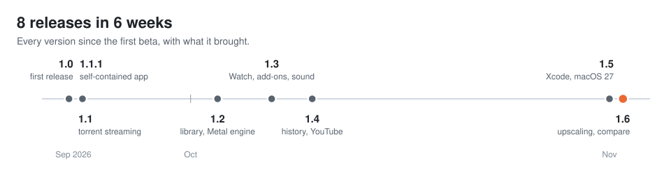
</picture>

Los cambios de cada versión están en [Releases](https://github.com/OZBM/MacLC/releases). Para enterarte de la próxima, haz clic en el botón **Watch** de GitHub en la parte superior de esta página y luego en **Custom › Releases**.

## Estado

MacLC está en fase beta y avanza rápido. Se desarrolla y se mide en un MacBook Pro con M3 Max, y cada versión reproduce un conjunto de archivos de muestra antes de publicarse. Aún sin verificar: Play on TV con receptores AirPlay y Chromecast reales (de ahí la etiqueta beta), VoiceOver y Reducir movimiento en la biblioteca y en Watch, una biblioteca real muy grande y el HDR en pantallas distintas a la de ese MacBook Pro. La mayoría de estos puntos son metas de donación de arriba.

## Licencia, marcas registradas y créditos

MacLC se publica bajo la **GNU General Public License 2.0 o posterior**. Contiene código de VLC, cuyo motor `libVLC` permanece bajo la LGPL 2.1 o posterior: consulta [`COPYING`](COPYING) y [`COPYING.LIB`](COPYING.LIB). Al igual que ocurre con VLC en algunas plataformas, la app distribuida queda de facto bajo la GPL 3.0 debido a las licencias de algunas bibliotecas incluidas. El código fuente completo correspondiente es este repositorio. La app también contiene `libmedialibrary` y `libdvbpsi` de VideoLAN (LGPL 2.1 o posterior) y TagLib (LGPL 2.1 o MPL 1.1), compiladas desde sus fuentes fijadas mediante los scripts anteriores. Las redes de SDR a HDR se diseñaron y entrenaron para MacLC con fotografías HDR CC0 de Poly Haven y se distribuyen bajo la LGPL 2.1 o posterior; la red de interpolación RIFE v4.25 proviene de [Practical-RIFE](https://github.com/hzwer/Practical-RIFE) (MIT, © 2021 hzwer).

**MacLC no está afiliado a VideoLAN, ni cuenta con su respaldo ni con su soporte.** VLC, VideoLAN y el logotipo del cono de tráfico son marcas registradas de VideoLAN; MacLC no los usa. Por favor, informa de los errores de MacLC aquí, no a VideoLAN. Dolby Vision es una marca registrada de Dolby Laboratories; los demás nombres pertenecen a sus propietarios.

Gracias al proyecto VideoLAN y a los numerosos voluntarios sobre cuyas dos décadas de trabajo en VLC se construye MacLC: consulta [`AUTHORS`](AUTHORS) y [`THANKS`](THANKS); el README original se conserva como [`README.upstream.md`](README.upstream.md).

La ilustración al inicio de la sección HDR es una escena inventada, renderizada desde cero en Blender. Las demás imágenes de esta página muestran películas abiertas: *Sintel*, *Big Buck Bunny*, *Tears of Steel* y *Elephants Dream* (© Blender Foundation, CC BY), *Cosmos Laundromat* (Andy Goralczyk y Blender Foundation, CC BY 4.0), *Spring* (Francesco Siddi, Blender Foundation, CC BY 4.0), *Sprite Fright* (Blender Studio, CC BY 4.0) y *Caminandes: Llama Drama* (Pablo Vazquez, Beorn Leonard, Francesco Siddi, CC BY 3.0), y panorámicas de Poly Haven (CC0).

<p align="center">
  <a href="https://github.com/OZBM/MacLC/releases/latest"><b>Descargar MacLC</b></a> ·
  <a href="https://www.hazenstudio.com/maclc/"><b>Sitio web</b></a> ·
  <a href="https://www.hazenstudio.com/maclc/donate/"><b>Donar</b></a>
</p>
