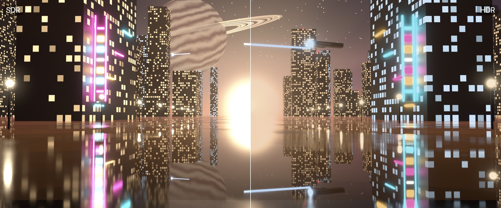

<!-- Traduction de README.md : la page en anglais est la référence. -->

<h1 align="center">
  <a href="https://github.com/OZBM/MacLC/releases/latest">
    
  </a>
</h1>

<p align="center">
  <b>Le lecteur vidéo gratuit pour Mac qui lit tout et fait rayonner l'image.</b><br>
  Vrai HDR, SDR&nbsp;vers&nbsp;HDR, neuf méthodes de mise à l'échelle, mouvement fluide, Voice&nbsp;Boost et une bibliothèque dans l'esprit de l'app Apple&nbsp;TV, dans une seule app native pour Apple&nbsp;Silicon.
</p>

<p align="center">
  <a href="https://github.com/OZBM/MacLC/releases/latest"></a>
  <a href="https://www.hazenstudio.com/maclc/donate/"></a>
</p>

<p align="center">
  
  
  
  <a href="COPYING"></a>
</p>

<p align="center">
  <a href="README.md">English</a> · <b>Français</b> · <a href="README.zh-CN.md">简体中文</a> · <a href="README.ja.md">日本語</a> · <a href="README.es.md">Español</a> · <a href="README.de.md">Deutsch</a>
</p>

<picture>
  <source media="(prefers-color-scheme: dark)" srcset=".github/readme/library-dark.webp">
  
</picture>

## Pourquoi MacLC

<table>
<tr>
<td width="50%" valign="top">

**Lit tout.** MKV, MP4, AVI, WebM, TS, AV1, HEVC, FLAC, DTS, sous-titres SRT, ASS et autres, ainsi que ces fichiers capricieux que d'autres lecteurs refusent. Aucun codec à installer.

</td>
<td width="50%" valign="top">

**Vrai HDR.** Dolby Vision, HDR10+, HDR10 et HLG avec leurs vraies hautes lumières sur un MacBook Pro ou tout écran HDR, et des sous-titres maintenus à un blanc confortable.

</td>
</tr>
<tr>
<td valign="top">

**SDR vers HDR.** Les vidéos ordinaires profitent de la réserve de luminosité de votre écran : lampes, ciels et reflets s'illuminent, tandis que les visages et les ombres restent fidèles à l'image filmée.

</td>
<td valign="top">

**Plus net, plus fluide.** Neuf méthodes de mise à l'échelle sur GPU (MetalFX, FSR, NIS, Anime4K…) pour les petites vidéos sur grand écran, et interpolation d'images jusqu'à la fréquence de rafraîchissement de votre écran, 120&nbsp;Hz avec ProMotion.

</td>
</tr>
<tr>
<td valign="top">

**Une vraie app Mac.** Liquid Glass, menus et raccourcis Mac, une bibliothèque dans l'esprit de l'app Apple TV et des réglages qui expliquent l'effet de chaque option.

</td>
<td valign="top">

**Et plus encore.** Voice Boost pour des dialogues plus clairs, Watch pour les catalogues d'extensions, des torrents lisibles pendant le téléchargement, YouTube (avec l'outil gratuit yt-dlp) et Play on TV (bêta).

</td>
</tr>
</table>

<p align="center"><b>Gratuit. Sans publicité, sans compte, sans pistage.</b> Open source sous licence GPL.</p>

## Un HDR qui exploite tout votre écran

**Vous lisez ceci sur un MacBook Pro ? Regardez l'image ci-dessous dans Safari.** C'est une illustration : une image de film inventée, entièrement rendue par ordinateur, étalonnée pour le SDR à gauche et pour le HDR à droite. Le SDR délave le néon et le soleil en un blanc uniforme ; sur un écran HDR, la moitié droite garde leurs couleurs et brille vraiment plus fort que le blanc de cette page.

<p align="center">
  
</p>

L'écran d'un MacBook Pro peut afficher des hautes lumières plusieurs fois plus lumineuses que le blanc. MacLC a été conçu autour de cette capacité.

- **Dolby Vision, HDR10+, HDR10 et HLG**, chacun restitué de la meilleure façon pour votre écran, y compris les vidéos HDR filmées à l'iPhone.
- **La bonne luminosité sur chaque écran.** MacLC mesure l'écran sur lequel se trouve chaque fenêtre, et remesure dès que vous la déplacez vers un autre moniteur.
- **Le HDR aussi sur les écrans ordinaires**, adapté à ce que l'écran peut afficher au lieu d'être écrêté en blanc plat.
- **Des sous-titres agréables à lire.** Ils restent d'un blanc reposant au lieu d'éblouir comme le point le plus lumineux du film.
- **AV1 matériel** sur M3 et plus récent, et AV1 logiciel partout ailleurs.

Le moteur vidéo Metal propre à MacLC assure le rendu Dolby Vision et HDR10+, et les six défauts HDR relevés dans le code dont il hérite sont corrigés ([détails](#sous-le-capot)).

### SDR vers HDR : de la lumière là où votre écran en a en réserve

La plupart des vidéos sont en SDR : leurs hautes lumières s'arrêtent au blanc, même sur un écran capable d'aller bien au-delà. SDR vers HDR élève ces hautes lumières dans la réserve de luminosité de votre écran, et garde les visages et les ombres proches de ce qui a été filmé.

<picture>
  <source media="(prefers-color-scheme: dark)" srcset=".github/readme/sdr-to-hdr-curve-dark.svg">
  
</picture>

Choisissez un niveau de Fast à Maximum, ou laissez Auto retenir celui que votre Mac peut tenir. High et Maximum font appel à de petits réseaux neuronaux entraînés pour MacLC, soit environ une demi-milliseconde par image sur un M3 Max. Vous réglez l'intensité maximale des hautes lumières, et **Hold to Compare** affiche l'original tant que vous maintenez le bouton.

<details>
<summary>Le voir sur une vraie vidéo</summary>

Une image du film libre *Sintel* en double : à gauche telle que filmée, à droite telle que MacLC l'a affichée sur un MacBook Pro avec SDR vers HDR au niveau Maximum, capturée depuis l'app. Sur un écran HDR dans Safari, le soleil à droite rayonne.


</details>

<p align="center">
  
</p>

## Plus net et plus fluide

**Mise à l'échelle.** Un épisode en 720p sur un écran 5K mérite mieux qu'un flou. MacLC agrandit les petites vidéos sur le GPU, avec neuf méthodes au choix, chacune expliquée simplement dans son panneau :

| Méthode | Idéal pour |
|---|---|
| Auto | Choisit pour vous : la super-résolution d'Apple sur les petites vidéos, puis MetalFX |
| Apple Neural 4x | Le modèle neuronal 4× d'Apple (téléchargé une seule fois depuis Apple) ; repasse en 2× si le Mac ne suit plus |
| Anime et Anime4K | L'animation dessinée : traits nets, aplats de couleur |
| FSRCNNX | Les fins détails (téléchargé uniquement après acceptation de sa licence) |
| Sharp (AMD FSR 1) et NIS (NVIDIA Image Scaling) | Des contours nets pour un coût quasi nul |
| Efficient (MetalFX) | L'autonomie sur batterie |
| Classic (EWA Lanczos) | Rester aussi fidèle que possible à la source |

Les passes neuronales d'Apple, Anime, Anime4K et FSRCNNX fonctionnent sur les vidéos SDR 8 bits. Sur les vidéos HDR et 10 bits, ainsi que lorsque SDR vers HDR est activé, MacLC utilise les autres méthodes.

**Compare Before and After.** Partagez l'image en deux sur la vidéo en cours : à gauche sans SDR vers HDR, mise à l'échelle ni interpolation, à droite avec.

**Mouvement fluide.** L'interpolation d'images porte le 24 i/s à la fréquence de rafraîchissement de votre écran : 60 Hz, 120 Hz sur un MacBook Pro ProMotion, ou davantage sur un moniteur externe rapide. Le mode automatique choisit une méthode qui suit en temps réel ; le flux optique et RIFE, un réseau de neurones, peuvent être sélectionnés à la main. L'option est désactivée par défaut, parce que les puristes du cinéma ont raison eux aussi.

<picture>
  <source media="(prefers-color-scheme: dark)" srcset=".github/readme/motion-demo-dark.svg">
  
</picture>

<p align="center">
  
</p>

## Une bibliothèque qu'on a plaisir à ouvrir

Indiquez vos dossiers à MacLC et il compose une bibliothèque dans l'esprit de l'app Apple TV : **Accueil** avec ce que vous regardiez, puis **Vidéos, Séries, Artistes, Albums, Morceaux, Genres, Favoris et Playlists**. Les épisodes nommés comme `Show S01E02` sont regroupés en saisons, les vignettes affichent les badges **Dolby Vision, HDR10, HLG et 4K**, et une capsule flottante En lecture garde l'image sous vos yeux pendant que vous naviguez. Vos fichiers ne bougent jamais.

**Watch** permet de parcourir des catalogues de films et de séries dans l'esprit de l'app Apple TV, avec sélections à la une, rangées thématiques, Top 10, genres et fiches détaillées avec distribution et épisodes. Cinemeta, intégré d'office, fournit les affiches, les informations et la recherche ; ce que vous pouvez lire dépend des extensions que vous installez, compatibles avec le [protocole d'extensions Stremio](https://github.com/Stremio/stremio-addon-sdk/blob/master/docs/protocol.md). Vos favoris, votre historique et Reprendre restent sur votre Mac.

<picture>
  <source media="(prefers-color-scheme: dark)" srcset=".github/readme/watch-dark.webp">
  
</picture>

- **Des torrents lisibles pendant le téléchargement.** Ouvrez un fichier `.torrent` ou collez un lien magnet : la lecture démarre dès que quelques secondes sont vérifiées, et un repère sur la barre de lecture indique la mémoire tampon, le débit et les pairs.
- **YouTube** avec Accueil, Abonnements, À regarder plus tard, playlists et recherche. Cette fonction repose sur l'outil gratuit [`yt-dlp`](https://github.com/yt-dlp/yt-dlp), et MacLC affiche l'unique commande permettant de l'installer. La connexion est facultative : sur la page officielle de Google, ou à partir de la session d'un navigateur où vous êtes déjà connecté. MacLC ne conserve que les cookies de session nécessaires à yt-dlp, dans un fichier privé sur votre Mac, et la déconnexion le supprime.
- **Play on TV (bêta).** Envoyez la lecture en cours vers une Apple TV ou un autre récepteur AirPlay, ou vers un Chromecast.

MacLC ne fournit ni films, ni séries, ni flux. Les extensions sont des services tiers : utilisez-les uniquement pour des contenus que vous avez le droit de regarder.

## Des dialogues faciles à suivre


**Voice Boost** rend les dialogues plus clairs sans monter la musique. Sur les films en 5.1, il relève la voie centrale (+7,4&nbsp;dB d'avantage mesuré sur les dialogues). En stéréo, il isole la voix au centre du mixage, en temps réel sur vDSP d'Apple (+4,8&nbsp;dB dans la bande vocale de 1 à 4&nbsp;kHz, mesuré sur un vrai mixage, environ 16&nbsp;ms de latence).

Également : les modes **Nuit, Cinéma, Musique, Renforcement des basses, Voix parlée, Casque et Petits haut-parleurs**, chacun doté d'un curseur d'intensité, d'un **égaliseur 10 bandes** (⌥⌘E) et d'un limiteur qui empêche les scènes fortes de saturer.

<br clear="right">

## Des réglages qui s'expliquent d'eux-mêmes

Une seule fenêtre, une barre latérale et un champ de recherche. Chaque ligne décrit l'effet du réglage sur ce que vous verrez ou entendrez. Les options avancées restent disponibles dans une section dépliable.

<picture>
  <source media="(prefers-color-scheme: dark)" srcset=".github/readme/settings-hdr-dark.webp">
  
</picture>

## Comparatif

|  | **MacLC** | IINA | Infuse | QuickTime Player |
|---|:---:|:---:|:---:|:---:|
| Lit presque tous les fichiers vidéo | ✅ | ✅ | ✅ certains formats audio nécessitent Pro | ❌ surtout MP4 et MOV |
| Vidéo HDR sur écran HDR | ✅ | ✅ | ✅ | ✅ |
| Fait rayonner les vidéos ordinaires sur écran HDR (SDR vers HDR) | ✅ | ❌ | ❌ | ❌ |
| Méthodes de mise à l'échelle intégrées | ✅ neuf | ➖ shaders à installer | ✅ un mode IA | ❌ |
| Mouvement fluide (interpolation d'images) | ✅ intégrée | ➖ via options mpv | ❌ | ❌ |
| Renforcement des dialogues en un clic | ✅ Voice Boost | ❌ filtres à régler à la main | ❌ hausse du volume uniquement | ❌ |
| Bibliothèque pour vos vidéos | ✅ et votre musique | ❌ playlists et historique | ✅ sa spécialité | ❌ |
| Catalogues d'extensions et torrents | ✅ | ❌ | ❌ | ❌ |
| YouTube et vidéos du web | ✅ avec yt-dlp | ✅ avec yt-dlp | ❌ | ❌ |
| Gratuit | ✅ | ✅ | ➖ Pro est payant | ✅ inclus avec macOS |
| Open source | ✅ GPL | ✅ GPL | ❌ | ❌ |

<sub>Vérifié le 3 novembre 2026 d'après la documentation et les notes de version de chaque lecteur. IINA est lui aussi excellent, gratuit et open source.</sub>

## Installation

<p>
  <a href="https://github.com/OZBM/MacLC/releases/latest"></a>
</p>

1. Téléchargez `maclc-1.6.dmg` (57,8 Mo) depuis [la dernière version](https://github.com/OZBM/MacLC/releases/latest).
2. Ouvrez l'image disque et glissez **MacLC** dans **Applications**.
3. Ouvrez MacLC. La première fois, macOS bloque l'ouverture : cliquez sur **Terminé**, puis ouvrez **Réglages Système › Confidentialité et sécurité**, descendez jusqu'à **Sécurité** et cliquez sur **Ouvrir quand même** à côté du message « L'ouverture de MacLC a été bloquée pour protéger votre Mac ». Confirmez avec Touch ID ou votre mot de passe. Vous ne le faites qu'une seule fois par version.

> [!NOTE]
> **Pourquoi ce clic supplémentaire ?** macOS n'ouvre une application d'un simple double-clic que lorsque son développeur verse 99 € par an à Apple pour un identifiant Developer ID et fait notariser chaque version. MacLC est gratuit et n'a pas encore réuni cette somme. **Les premiers 99 € de dons supprimeront cette étape pour tout le monde.** [Faire un don](https://www.hazenstudio.com/maclc/donate/)

<details>
<summary>Alternative dans le Terminal, somme de contrôle et configuration requise</summary>

Plutôt que **Ouvrir quand même**, vous pouvez retirer l'attribut « téléchargé depuis Internet » :

```bash
xattr -dr com.apple.quarantine /Applications/MacLC.app
```

Vérifiez que votre copie est identique à celle publiée (la valeur attendue figure sur la page de la version ; pour la 1.6, c'est `194de0b42a836985dba92a75d283264e21b4285f5a24934769b0e2aad5aae805`) :

```bash
shasum -a 256 ~/Downloads/maclc-1.6.dmg
```

Si macOS indique un jour que MacLC « est endommagé et ne peut pas être ouvert », le téléchargement est incomplet : supprimez-le et téléchargez-le de nouveau. Ne contournez pas ce message.

**Configuration requise**

- Un Mac avec Apple Silicon (M1 ou plus récent). Les Mac Intel ne sont pas pris en charge.
- macOS 26 Tahoe ou ultérieur.
- SDR vers HDR nécessite un écran capable d'aller au-delà du blanc (MacBook Pro avec écran XDR, Pro Display XDR, moniteur HDR). Tout le reste fonctionne sur n'importe quel écran.
- Facultatif : [`yt-dlp`](https://github.com/yt-dlp/yt-dlp) pour YouTube et les vidéos du web (`brew install yt-dlp`).

L'application est autonome : FFmpeg, libass, libplacebo, libtorrent et environ 140 autres bibliothèques y sont intégrées, avec leurs licences dans `MacLC.app/Contents/Resources/Licenses/`.

</details>

## Soutenir MacLC

MacLC est un projet personnel : pas de publicité, pas d'abonnement, aucune donnée à revendre. Les dons financent ce qu'une application gratuite ne peut pas obtenir seule, dans cet ordre :

<picture>
  <source media="(prefers-color-scheme: dark)" srcset=".github/readme/donation-milestones-dark.svg">
  
</picture>

**Chaque don s'accompagne d'un vœu.** Dites-moi ce que MacLC devrait faire ensuite, ou soutenez un vœu déjà proposé : les plus soutenus passent en premier. Réglez par PayPal ou par carte sur [la page de dons](https://www.hazenstudio.com/maclc/donate/), où le montant collecté s'affiche en direct.

<p align="center">
  <a href="https://www.hazenstudio.com/maclc/donate/"></a>
</p>

**Pas de budget ? Ceci aide tout autant :**

- ⭐ **Ajoutez une étoile à ce dépôt.** C'est grâce aux étoiles que l'on découvre MacLC sur GitHub.
- **Parlez-en autour de vous.** Partagez sur [X](https://x.com/intent/post?text=MacLC%3A%20the%20free%20video%20player%20for%20Mac%20that%20plays%20everything%2C%20with%20real%20HDR%2C%20SDR%20to%20HDR%2C%20upscaling%20and%20smooth%20motion.&url=https%3A%2F%2Fgithub.com%2FOZBM%2FMacLC), [Bluesky](https://bsky.app/intent/compose?text=MacLC%3A%20the%20free%20video%20player%20for%20Mac%20that%20plays%20everything%2C%20with%20real%20HDR%2C%20SDR%20to%20HDR%2C%20upscaling%20and%20smooth%20motion.%20https%3A//github.com/OZBM/MacLC), [Reddit](https://www.reddit.com/submit?url=https%3A%2F%2Fgithub.com%2FOZBM%2FMacLC&title=MacLC%3A%20a%20free%2C%20open-source%20video%20player%20for%20Mac%20with%20real%20HDR%20and%20SDR%20to%20HDR) ou [LinkedIn](https://www.linkedin.com/sharing/share-offsite/?url=https%3A%2F%2Fgithub.com%2FOZBM%2FMacLC).
- **Signalez ce que vous constatez.** Un fichier qui refuse de se lire, un plantage, une couleur fausse : [ouvrez un ticket](https://github.com/OZBM/MacLC/issues/new) en décrivant ce que vous avez fait et ce que vous attendiez.
- **Testez sur votre écran.** Jusqu'ici, le HDR de MacLC n'a été vérifié que sur un seul MacBook Pro. Si vous possédez un autre écran HDR, dites-moi ce que cela donne.

## Questions

<details>
<summary><b>MacLC est-il vraiment gratuit ?</b></summary>

Oui. Pas de version payante, pas d'abonnement, pas de publicité, pas de compte et aucune fonction bridée. Le projet est open source sous licence GPL 2.0 ou ultérieure.
</details>

<details>
<summary><b>Est-ce sûr ? Pourquoi macOS le bloque-t-il la première fois ?</b></summary>

Tout le code source est public dans ce dépôt, et MacLC ne comporte ni mesure d'audience ni pistage : il ne transmet ce que vous regardez ni à son développeur ni à qui que ce soit. Watch, YouTube et les torrents se connectent aux services qu'ils utilisent, comme n'importe quelle application. macOS ne bloque MacLC au premier lancement que parce qu'il n'est pas notarisé par Apple, ce qui coûte 99 € par an (voir [Installation](#installation)). Chaque version publie l'empreinte SHA-256 de l'image disque afin que vous puissiez vérifier votre copie.
</details>

<details>
<summary><b>Ai-je besoin d'un écran HDR ?</b></summary>

Non. MacLC lit toutes les vidéos sur n'importe quel écran Mac et adapte les films HDR aux écrans ordinaires. Seul SDR vers HDR nécessite un écran capable d'aller au-delà du blanc.
</details>

<details>
<summary><b>Fonctionne-t-il sur les Mac Intel, ou sur macOS 15 et antérieur ?</b></summary>

Non. MacLC cible Apple Silicon et macOS 26 Tahoe ou ultérieur, et les bibliothèques embarquées exigent macOS 26.
</details>

<details>
<summary><b>Comment mettre à jour MacLC ?</b></summary>

Téléchargez la nouvelle image disque depuis [Releases](https://github.com/OZBM/MacLC/releases) et remplacez l'application. Les mises à jour automatiques figurent parmi les paliers de dons. Pour être informé des nouvelles versions, cliquez sur le bouton **Watch** de GitHub en haut de cette page, puis sur **Custom › Releases**.
</details>

<details>
<summary><b>Le mouvement fluide ne donne-t-il pas aux films un effet « feuilleton télé » ?</b></summary>

C'est possible, et c'est pourquoi il est désactivé par défaut. Beaucoup l'apprécient pour le sport, la nature et l'animation, tout en gardant le rendu classique à 24 images par seconde pour le cinéma. Essayez les deux sur une même scène.
</details>

<details>
<summary><b>MacLC inclut-il des films ou des séries ?</b></summary>

Non. MacLC lit vos propres fichiers et ce que vous ouvrez. Watch affiche les catalogues des extensions que vous choisissez d'installer, qui sont des services tiers : utilisez-les uniquement pour des contenus que vous avez le droit de regarder.
</details>

## Sous le capot

MacLC s'appuie sur une partie du code open source de VLC 4, principalement son moteur de lecture (`libVLC`). L'interface, la bibliothèque et Watch, la sortie vidéo Metal, le pipeline HDR, SDR vers HDR, la mise à l'échelle, l'interpolation de mouvement, Voice Boost et AirPlay ont été écrits ou reconstruits pour MacLC, uniquement pour macOS sur Apple Silicon.

<details>
<summary><b>Pipeline HDR : six défauts corrigés dans le code hérité</b></summary>

Issu d'un audit de la chaîne HDR macOS de VLC 4.0.0-dev sur Apple Silicon (2 septembre 2026, base `99034f9`) :

| Défaut | Ce qui se voyait | Correctif |
|---|---|---|
| Réserve EDR lue une seule fois depuis `[NSScreen mainScreen]` | Déplacer la fenêtre sur un autre écran laissait le HDR à la mauvaise luminosité | Réserve réévaluée à chaque changement d'écran, de profil ou de paramètres |
| Les préférences de mode HDR et de réserve EDR n'avaient aucun effet | Les réglages étaient purement décoratifs | Reliées à des rappels de variables en direct, appliqués pendant la lecture |
| Aucune branche de tone-mapping SDR | Les films HDR sur écran SDR étaient écrêtés en blanc plat | `CADynamicRangeStandard` avec `CAToneMapModeAutomatic`, repli par ré-étiquetage BT.709 |
| Sous-titres non balisés au-dessus d'une vidéo PQ | Sous-titres blancs à pleine luminance PQ sur les scènes sombres | Calque de sous-titres balisé sRGB, mis à l'échelle sur le blanc de référence BT.2408 |
| HEVC au-delà de 10 bits sous-échantillonné en BGRA 8 bits | Les sources 12 bits et 16 bits perdaient des bits avant l'écran | Acheminement en P010 ; 4:2:2 16 bits relié via les fonctions d'aide CVPX |
| HDR sous 4K marqué BT.709, volume de mastering émis à zéro nit | Contenus à large gamme affichés avec les mauvaises primaires | Marquage exact par flux, volume de mastering jamais nul |

Également : transmission des métadonnées dynamiques HDR10+ à travers la chaîne de filtres, extraction des métadonnées Dolby Vision depuis le flux binaire VideoToolbox (profils 5 et 8.1 dans le moteur Metal de MacLC, 8.4 depuis l'iPhone), transfert des métadonnées ST 2086 et CTA-861.3 à la couche d'affichage, profil ICC par fenêtre, décodage matériel AV1 sur M3 et plus récent, et conversions chromatiques ARM64 NEON.
</details>

<details>
<summary><b>Comment fonctionne SDR vers HDR</b></summary>

L'image est linéarisée et l'impulsion de chaque pixel correspond au maximum entre sa luminance et 85 % de son canal le plus lumineux. Fast relève le signal au-dessus de la moitié du blanc SDR selon une courbe quadratique fixe ; Balanced ne relève que ce qui dépasse le blanc diffus, dans une proportion qui diminue lorsque de grandes zones sont claires. Dans les deux cas, les trois composantes sont multipliées par le même facteur, de sorte que la teinte et la saturation ne bougent pas. High et Maximum utilisent deux petits réseaux entraînés pour MacLC, qui prédisent une grille de gains de luminosité pour chaque scène, avec des gains par canal maintenus à moins de 0,2 (en log) du gain de luminance. Le résultat est borné à la réserve réelle de l'écran, avec un adoucissement progressif sous ce plafond, et balisé afin que le compositeur ne lui réapplique pas de tone-mapping vers le bas. Les sources déjà en HDR ne sont pas touchées. Les formules se trouvent dans [`maclc_sdr2hdr.h`](modules/video_output/apple/maclc_sdr2hdr.h) et les noyaux Metal dans [`VLCHDRExpander.m`](modules/video_output/apple/VLCHDRExpander.m).
</details>

<details>
<summary><b>Moteur de mise à l'échelle, coût et licences</b></summary>

La mise à l'échelle s'exécute dans la sortie vidéo Metal de MacLC dès que la fenêtre est au moins 1,2 fois plus grande que la vidéo. Mesures sur un M3 Max : MetalFX spatial de 0,4 à 0,84 ms par image, AMD FSR 1 de 720p à 1440p environ 0,5 ms, NIS de 720p à 4K 1,19 ms, ArtCNN de 540p à 1080p environ 2,1 ms. Les passes neuronales se mettent en retrait sur batterie, en mode Économie d'énergie, lorsque le Mac chauffe ou lorsqu'une image prendrait plus de 60 % du temps imparti. Un traducteur exécute les shaders de type hook mpv, ce qui permet à Anime4K et FSRCNNX de tourner sous Metal.

Licences : NIS et FSR 1 (MIT, avec les mentions de NVIDIA et d'AMD conservées telles quelles), Anime4K et ArtCNN (MIT), FSRCNNX (LGPL-3.0, téléchargé uniquement après acceptation de sa licence), MetalFX et la super-résolution VideoToolbox (frameworks système d'Apple).
</details>

<details>
<summary><b>Options en ligne de commande ajoutées</b></summary>

| Option | Valeurs | Effet |
|---|---|---|
| `--macosx-hdr-mode` | 0 à 3 | 0 Auto, 1 forcer le HDR natif, 2 tone-mapping vers SDR, 3 HDR désactivé |
| `--macosx-edr-headroom` | float | 0 suit l'écran ; 1 ou plus impose une réserve de luminosité |
| `--macosx-sdr-to-hdr` | bool | Étend la vidéo SDR dans la plage étendue de l'écran |
| `--macosx-sdr-to-hdr-boost` | 1 à 16 | Niveau maximal des hautes lumières au-dessus du blanc SDR (4 par défaut) |
| `--macosx-sdr-to-hdr-quality` | auto, fast, balanced, high, maximum | Niveau de SDR vers HDR |
| `--maclc-upscale`, `--maclc-upscale-method` | bool, string | Active ou désactive la mise à l'échelle, et choisit la méthode |

</details>

<details>
<summary><b>Compiler depuis les sources</b></summary>

MacLC se compile sur un Mac Apple Silicon avec autotools et les bibliothèques de Homebrew. Meson ne compile pas l'interface macOS : utilisez autotools, ou le projet Xcode pour travailler sur l'interface.

```bash
# once: the media library engine, TagLib and libdvbpsi, built from contrib/src's pinned versions
extras/package/macosx/build-medialibrary.sh
extras/package/macosx/build-taglib.sh
extras/package/macosx/build-dvbpsi.sh

# configure a development build in build/, then:
make -C build -j12
make -C build package-macosx          # signed MacLC.app and maclc-<version>.dmg

# interface work in Xcode (deploys the plugin into build/MacLC.app)
xcodebuild -project extras/package/macosx/MacLC.xcodeproj -scheme MacLC build

# a release: clean build in build-release/, checks, smoke test on sample files, SHA-256
extras/package/macosx/make-release.sh --samples ~/Movies/maclc-samples
```

Configurez en plaçant d'abord `build-deps/prefix/lib/pkgconfig` et `build-deps/pkgconfig` dans `PKG_CONFIG_PATH` ; `automake` 1.18 est requis pour régénérer `Makefile.in` ; tout fichier utilisant `_NS("…")` doit figurer dans `po/POTFILES.in`. Les tests unitaires (308, XCTest) se lancent avec `make check-macosx` depuis `build/modules`, et `MACLC_SELFTEST=1` construit les principaux panneaux de réglages au démarrage et indique ce qui s'est affiché. L'icône de l'application est générée par un programme Swift inclus dans le dépôt, [`maclc_app_icon.swift`](extras/package/macosx/asset_sources/maclc_app_icon.swift).
</details>

## Versions

<picture>
  <source media="(prefers-color-scheme: dark)" srcset=".github/readme/releases-dark.svg">
  
</picture>

Les changements de chaque version figurent dans [Releases](https://github.com/OZBM/MacLC/releases). Pour être prévenu de la prochaine, cliquez sur le bouton **Watch** de GitHub en haut de cette page, puis sur **Custom › Releases**.

## État du projet

MacLC est en bêta et évolue vite. Il est développé et mesuré sur un MacBook Pro M3 Max, et chaque version lit un jeu de fichiers de test avant sa publication. Pas encore vérifié : Play on TV avec de vrais récepteurs AirPlay et Chromecast (d'où la mention bêta), VoiceOver et Réduire les animations dans la bibliothèque et Watch, une très grande bibliothèque réelle, ainsi que le HDR sur d'autres écrans que celui de ce MacBook Pro. La plupart de ces points correspondent à un palier de dons ci-dessus.

## Licence, marques et crédits

MacLC est publié sous la **GNU General Public License 2.0 ou ultérieure**. Il contient du code issu de VLC, dont le moteur `libVLC` reste sous licence LGPL 2.1 ou ultérieure : voir [`COPYING`](COPYING) et [`COPYING.LIB`](COPYING.LIB). Comme pour VLC sur certaines plateformes, l'application distribuée relève de fait de la GPL 3.0 en raison des licences de certaines bibliothèques embarquées. Le code source complet correspondant est ce dépôt. L'application intègre également `libmedialibrary` et `libdvbpsi` de VideoLAN (LGPL 2.1 ou ultérieure) ainsi que TagLib (LGPL 2.1 ou MPL 1.1), compilés à partir de leurs versions figées par les scripts ci-dessus. Les réseaux SDR vers HDR ont été conçus et entraînés pour MacLC sur des photographies HDR CC0 de Poly Haven et sont distribués sous licence LGPL 2.1 ou ultérieure ; le réseau d'interpolation RIFE v4.25 provient de [Practical-RIFE](https://github.com/hzwer/Practical-RIFE) (MIT, © 2021 hzwer).

**MacLC n'est ni affilié à VideoLAN, ni approuvé ou pris en charge par VideoLAN.** VLC, VideoLAN et le logo au cône de signalisation sont des marques de VideoLAN ; MacLC ne les utilise pas. Merci de signaler les bugs de MacLC ici, et non auprès de VideoLAN. Dolby Vision est une marque de Dolby Laboratories ; les autres noms appartiennent à leurs propriétaires respectifs.

Merci au projet VideoLAN et aux nombreux bénévoles dont les deux décennies de travail sur VLC servent de fondation à MacLC : voir [`AUTHORS`](AUTHORS) et [`THANKS`](THANKS) ; le README d'origine est conservé sous [`README.upstream.md`](README.upstream.md).

L'illustration en tête de la section HDR est une scène inventée, rendue de toutes pièces dans Blender. Les autres images de cette page montrent des films libres : *Sintel*, *Big Buck Bunny*, *Tears of Steel* et *Elephants Dream* (© Blender Foundation, CC BY), *Cosmos Laundromat* (Andy Goralczyk et la Blender Foundation, CC BY 4.0), *Spring* (Francesco Siddi, Blender Foundation, CC BY 4.0), *Sprite Fright* (Blender Studio, CC BY 4.0) et *Caminandes: Llama Drama* (Pablo Vazquez, Beorn Leonard, Francesco Siddi, CC BY 3.0), ainsi que des panoramas de Poly Haven (CC0).

<p align="center">
  <a href="https://github.com/OZBM/MacLC/releases/latest"><b>Télécharger MacLC</b></a> ·
  <a href="https://www.hazenstudio.com/maclc/"><b>Site web</b></a> ·
  <a href="https://www.hazenstudio.com/maclc/donate/"><b>Faire un don</b></a>
</p>
